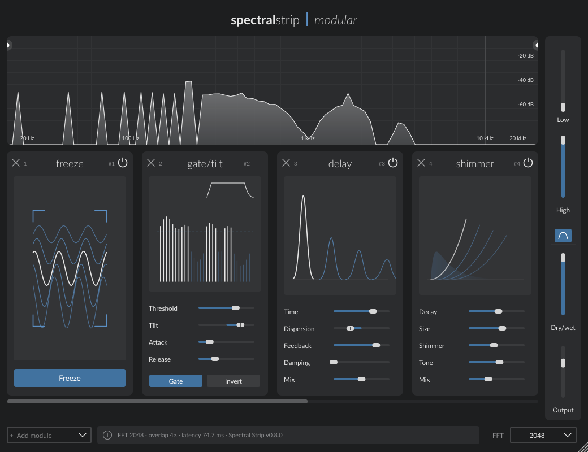

# Spectral Strip

A modular spectral multi-effect plug-in for macOS, Windows and Linux (AU, VST3 and
standalone), written in C++ with [JUCE](https://juce.com).



Spectral Strip takes the sound apart into its frequencies, lets a chain of effects work on
them, and puts it back together. You build the chain yourself: up to 20 effects, in any
order, each acting only on the frequency band you choose.

## Features

- **Six spectral effects**, each usable several times in the same chain:
  - **Freeze** – captures the current spectrum and holds it as an evolving drone.
  - **Gate / Tilt** – keeps or removes frequency components by level (with attack and
    release), plus a tone tilt that darkens or brightens around 1 kHz.
  - **Delay** – echoes per frequency; *Dispersion* gives lows and highs different delay
    times, *Damping* darkens each repeat.
  - **Blur** – smears energy between neighbouring frequencies.
  - **Tremolo** – volume modulation from a smooth sine to short pulses.
  - **Shimmer** – a reverb with an octave-up voice feeding its tail.
- **Reorderable chain**: drag a module by its title; the order changes the sound.
- **Frequency band**: *Low* and *High* limit where the effects act; *Filter* can also cut
  everything outside the band.
- **Live analyser** with draggable band edges, and an **info bar** that explains the
  control under the mouse and shows its value.
- **Selectable FFT size** (512–8192): smaller is faster and more precise in time, larger
  is finer in frequency.
- **Latency compensated** dry/wet mix, full host automation, settings saved with the session.

## How to use it

1. Insert Spectral Strip on a track and play some audio.
2. Click **+ Add module** (bottom left) or the **+** in the empty dashed slot to add an effect.
3. Shape it with its sliders; the drawing at the top of each module shows what the
   settings do. Hover any control to read its value and a short explanation in the info bar.
4. Use the **power icon** to switch a module off, **×** to remove it, and drag its title
   to move it. Scroll the strip with the trackpad, the mouse wheel or the bar below it.
5. Set the band with **Low / High** in the sidebar (or the dots on the analyser), then
   balance the result with **Dry/wet** and **Output**.

A few starting points:

- *Vocal drone*: Freeze, press **Freeze** during a sustained vowel.
- *Spectral rain*: Delay with Time 180 ms, Dispersion 0.8, Feedback 0.6, Mix 0.7.
- *Shimmering pad*: Freeze → Shimmer with Decay 10 s and Shimmer 0.7.
- *Hidden details*: Gate with **Invert** on and Threshold around -45 dB.

The plug-in adds latency (one FFT frame, 42.7 ms at 48 kHz with the default size, plus
3/4 of a frame per Shimmer module), which the host compensates. It is meant for mixing
and sound design rather than live monitoring.

## How it works

**One shared spectrum.** The input is cut into overlapping windowed frames (short-time
Fourier transform, 4× overlap). Every frame is transformed once; the modules then edit the
same complex spectrum one after another, and an inverse transform with overlap-add rebuilds
the audio. Adding modules therefore does not add FFTs or latency (except Shimmer, which
works in the time domain between an extra pair of transforms).

**Chain and slots.** The chain is a list of up to 20 entries. Each entry names an effect
type and a *slot*: the instance whose parameters and memory it uses. Moving an entry keeps
its slot, so a module keeps its settings wherever it goes, and a removed module's settings
come back if it is added again. Parameters of empty slots are hidden from host automation.

**Band and smoothing.** A soft band mask, computed once per frame, decides how much each
frequency is processed. Parameter changes are smoothed per frame (about 35 ms) to avoid
clicks.

**Real-time safety.** The audio thread never allocates, waits or touches the UI. Memory for
Delay and Shimmer is allocated on the message thread when a module is inserted; chain
changes are published without locks; FFT size, chain and session changes fade out, switch
in silence and fade back in.

### Code map

| File | Role |
| --- | --- |
| `Source/SpectralEngine.h` | STFT engine and all spectral effects (one function per effect). |
| `Source/ShimmerReverb.h` | Time-domain reverb used by the Shimmer module. |
| `Source/PluginProcessor.*` | Parameters, chain, session save/load and compatibility, audio callback. |
| `Source/PluginEditor.*` | Main window: title, sidebar, bottom bar, info bar. |
| `Source/UI/` | Analyser, scrolling module strip, module definitions, drawings, look and feel. |
| `Tests/` | Test runner (DSP, state, threading), AU stress tool, editor preview app. |

To add a new effect: give it a type in `SpectralEngine::ModuleType`, an `apply…` function
in the engine, its parameters in `PluginProcessor.cpp` (appended, never inserted, so old
sessions keep working), and a `ModuleSpec` in `Source/UI/ModuleSpecs.h` for its controls.

## Download and install

Builds for each release are on the [Releases](https://github.com/george4009/Spectral_Strip/releases) page.

- **macOS**: copy `Spectral Strip.component` to `~/Library/Audio/Plug-Ins/Components/` and
  `Spectral Strip.vst3` to `~/Library/Audio/Plug-Ins/VST3/`.
- **Windows**: copy `Spectral Strip.vst3` to `C:\Program Files\Common Files\VST3\`.
- **Linux**: copy `Spectral Strip.vst3` to `~/.vst3/`.

Rescan plug-ins in your DAW. The builds are not signed by a registered developer, so
macOS and Windows may ask for confirmation the first time.

## Build from source

You need CMake 3.22+, a C++17 compiler and JUCE 9 with the small AU patch in `patches/`:

```sh
git clone https://github.com/juce-framework/JUCE.git --branch 9.0.2
git -C JUCE apply ../Spectral_Strip/patches/juce-au-automatable-parameter-list.patch
cmake -S Spectral_Strip -B build -DJUCE_PATH=$PWD/JUCE -DCMAKE_BUILD_TYPE=Release
cmake --build build --config Release
ctest --test-dir build -C Release      # run the tests
```

On macOS, `scripts/build-and-install.command` builds, tests, packages and installs in one
step. More details are in [docs/BUILDING.md](docs/BUILDING.md); changes are listed in
[CHANGELOG.md](CHANGELOG.md).

## License

GNU AGPL v3 – see [LICENSE](LICENSE). The interface font is a subset of Lato
(SIL Open Font License, see [licenses](licenses)).
